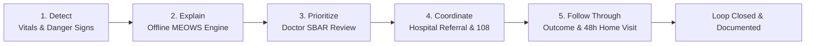

# CARESYNC AI (கேர்சின்க் ஏஐ / केयरसिंक एआई)
### Rural Care Continuity and Coordination Platform
> *"From the first warning to the completed follow-up."*

---

## 🌟 Executive Summary

In rural health systems across India, dangerous clinical warnings detected at village sub-centres often fail to become completed hospital care due to broken communication channels, intermittent cellular coverage, uncoordinated transport, and zero postpartum follow-up.

**CARESYNC AI** is a mobile-first, offline-first Progressive Web Application (PWA) designed specifically for frontline healthcare workers. It enforces a strict **CARE LOOP**:
$$\text{Detect} \longrightarrow \text{Explain} \longrightarrow \text{Prioritize} \longrightarrow \text{Coordinate} \longrightarrow \text{Follow Through}$$

> **Core Philosophy**: A clinical care loop is **never marked closed** until a verified clinical outcome and an in-person community follow-up visit have been documented.

---

## 🏥 Clinical Domain & Hero Pathway

- **Focus**: Maternal Danger Signs & Severe Pre-Eclampsia / Eclampsia.
- **Hero Case**: **Lakshmi Devi** (24y, 34 weeks gestation, G1P0) presenting at Asha Nagar Village Sub-Centre. Initially baseline stable, her subsequent observation of Blood Pressure **160/110 mmHg** with **severe headache** triggers an immediate **CRITICAL RED** danger alert under MEOWS combination rules.
- **Decision Support Disclaimer**: CARESYNC AI operates strictly as clinical workflow decision-support using simulated data. It never diagnoses autonomously; a trained healthcare clinician must confirm every action.

---

## ⚡ Tech Stack & Architecture

- **Frontend Core**: React 19, TypeScript, Vite 6, Tailwind CSS v4.
- **PWA Installation**: Custom Service Worker (`public/sw.js`), Web App Manifest (`public/manifest.json`), installable on Android tablets, smartphones, and desktop kiosks.
- **Offline Storage**: Dexie.js (IndexedDB) with append-only local storage.
- **Simulated Cloud Server**: Second isolated IndexedDB database (`CareSyncCloudDB`) enabling genuine bi-directional push/pull synchronization with zero external backend dependencies.
- **Charts & Visualization**: Recharts for longitudinal BP/Pulse trajectory lines with clinical MEOWS threshold overlays, referral bottleneck bar charts, and stage delay monitors.
- **Design System**:
  - **Light Mode**: Background `#F6FAF9`, Surface `#FFFFFF`, Text `#0F2A2E`, Primary Teal `#0D9488`, Accent `#6366F1`.
  - **Dark Mode**: Background `#0B1517`, Surface `#12232A`, Text `#E6F4F1`, Primary Teal `#2DD4BF`, Accent `#818CF8`.
  - **Severity Badges**: WCAG AA contrast compliant, dual-coded with color, icons, and text labels (Never color alone).
  - **Mobile-First UX**: Minimum 48px touch targets, rounded 16px cards, Inter typography.
- **Multilingual Support**: Instant runtime toggle between **English**, **Tamil (தமிழ்)**, and **Hindi (हिंदी)** for all core navigation, loop stages, and actions.

---

## 👥 4 Tailored Clinical Roles

1. **Nurse / ANM (Meena)** — *Asha Nagar Village Sub-Centre*
   - Records maternal vitals, checklist of 8 danger signs, and local audio voice notes.
   - Triggers offline MEOWS evaluation, acknowledges alert timers, and dispatches SBAR senior review requests.
2. **PHC Doctor (Dr. Arun)** — *Shanti Puram Primary Health Centre*
   - Escalation inbox with deterministic auto-drafted SBAR (Situation, Background, Assessment, Recommendation).
   - Authorizes emergency 108 hospital transfers or prescribes sub-centre monitoring protocols.
   - Authority to modify MEOWS clinical thresholds in settings.
3. **Hospital Staff (Sister Priya)** — *Rampur District Hospital (FRU)*
   - Live intake receiving desk: Accepts/declines inbound referrals with real bed reservations.
   - Bedside arrival and handover verification checklist.
   - Documents treatment outcomes (`treated_stabilized`, `admitted_icu`, `delivered_safely`), which automatically instantiates 48-hour community follow-up tasks.
4. **District Health Officer (Dr. Rajesh Verma)** — *District Administration HQ*
   - Monitors the **Care Continuity Index**, bottleneck delays, stalled care loop alarms, and exports district CSV audits.

---

## 🔄 The 5-Stage Care Loop



---

## 📱 Offline-First & GSM SMS Fallback

When health sub-centres lose cellular connectivity:
1. **Append-Only Buffer**: Every reading, alert, escalation, and referral is written to local IndexedDB (`localDb.syncQueue`).
2. **Offline Referral Warning**: Displays amber badge: `"Saved on device - NOT yet sent"`.
3. **SMS Fallback Dispatcher**: Generates pre-formatted emergency dispatch text with patient vitals, reason, and callback number for zero-data transmission over GSM SMS.
4. **Auto-Reconnection**: Turning off the "Simulate Offline" toggle triggers automatic two-way synchronization (`syncNow()`), pushing local changes and pulling cloud hospital updates.

---

## 🚀 11-Step Guided Hero Scenario Demo

Click the **"Run Hero Scenario"** button in the header at any time to open the floating walkthrough guide:
1. **Simulate Offline**: Toggle offline mode to replicate a remote village sub-centre.
2. **Record Danger Signs**: Open Lakshmi Devi, enter BP 160/110 mmHg and check "Severe Headache".
3. **Inspect MEOWS Alert**: Observe the combination rule firing CRITICAL RED with plain-language rationale.
4. **Request Senior Review**: Submit urgent SBAR escalation to Shanti Puram PHC.
5. **Doctor Review & Referral**: Switch role to Dr. Arun, inspect editable SBAR, and authorize hospital transfer.
6. **Offline SMS Fallback**: Inspect offline referral badge and preview emergency SMS text.
7. **Reconnect & Sync**: Re-enable network, click "Sync Now", and observe the queue flush.
8. **Hospital Bed Reservation**: Switch role to Sister Priya at District Hospital and click "Accept Referral".
9. **Ambulance Handover**: Mark patient arrived and verify bedside clinical transfer.
10. **Document Outcome**: Record "Treated & Stabilized (IV MgSO4 + Labetalol)", which auto-creates a 48-hour ANM home follow-up task.
11. **District Manager KPI**: Switch role to District Manager, view closed loop index, and download CSV audit report.

---

## 🧪 Testing & Verification

The codebase includes automated unit test suites verifying the offline logic:

```bash
# 1. Run MEOWS Rules Engine Tests (13 test cases)
npx tsx src/rules/rulesEngine.test.ts

# 2. Run Sync Queue & Offline Reconciliation Tests (8 test cases)
npx tsx src/db/syncQueue.test.ts

# 3. Type-check entire project
npm run lint

# 4. Build production bundle
npm run build
```

---

## ⚠️ Known Limitations & Simulated Scope

1. **Simulated Telemetry**: Blood pressure, pulse, SpO2, and temperatures are simulated or entered manually. Real-world deployment would pair with Bluetooth low-energy (BLE) blood pressure cuffs and pulse oximeters.
2. **Simulated Cloud**: Two-way sync is demonstrated using twin IndexedDB databases (`CareSyncLocalDB` and `CareSyncCloudDB`) so that the application functions 100% locally in the browser with zero cloud server costs.
3. **Security Disclaimer**: Prototype uses local PIN lock (`1234`). Production healthcare software must integrate Android Keystore hardware-backed encryption, ABHA (Ayushman Bharat Health Account) authentication, and HIPAA/DISHA compliance.
4. **Clinical Disclaimer**: *"Prototype with simulated data. Thresholds must be validated by clinicians before any real use."*
